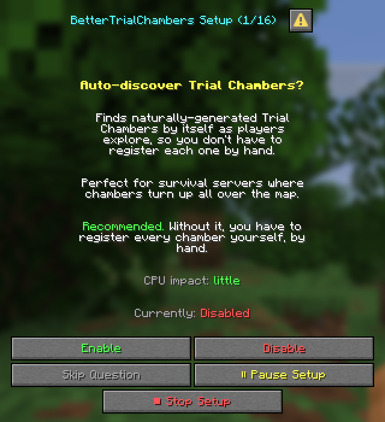

# BetterTrialChambers

Turn Minecraft's one-time Trial Chambers into replayable multiplayer dungeons.
Every player gets their own vault loot, chambers rebuild themselves on a timer,
and nobody can grief the spawners. It finds the chambers in your world by
itself, so there is no setup per chamber.

## Setup

1. Drop the jar in `plugins/`. One jar works on every Minecraft version from
   1.21.1 to 26.3, on Paper, Purpur, Pufferfish and Folia, with Java 21 or
   newer.
2. Start the server and join as an operator.
3. Run `/trial setup` and answer the questions. Turn on the first two.
4. Explore. Every Trial Chamber a player comes near is registered, saved and
   put on a timer to rebuild.

The [docs](https://esmp-fun.gitbook.io/plugins/better-trial-chambers) take you
through it step by step, with a picture of every screen:

* [Install it](docs/getting-started/installation.md)
* [Run the setup tour](docs/getting-started/quick-start.md)
* [Your first chamber is found](docs/getting-started/first-chamber.md)
* [What players see](docs/running-chambers/what-players-see.md) and the rest of
  [Run your chambers](docs/running-chambers/admin-menu.md)
* [Register a chamber by hand](docs/getting-started/your-first-chamber.md), for
  worlds with no chambers of their own
* [Commands](docs/reference/commands.md), [config.yml](docs/configuration/config.yml.md),
  [loot.yml](docs/configuration/loot.yml.md), [Troubleshooting](docs/troubleshooting.md)

## What it does

* **Per-player vaults.** Each player opens each vault once and gets their own
  reward. Or make it first come, first served.
* **Resets.** Chambers rebuild on a timer, with a warning for the players
  inside first.
* **Protection.** No breaking, building, lava or pistons inside a chamber,
  changeable per chamber. Land claim plugins can't claim over one.
* **Your own loot.** Edit what vaults hand out from a menu, per chamber, with
  money, commands and items from other plugins.
* **During a fight.** A boss bar counts the mobs left, and players who die can
  watch their group finish.
* **Stats.** Vaults opened, mobs killed, chambers cleared and time spent, with
  leaderboards and PlaceholderAPI placeholders.
* **Admin menu.** `/trial menu` covers all of it without opening a file.

## Premium add-ons

These need BetterTrialChambers and are sold on [esmp.fun](https://esmp.fun/).

* **[Mythic Trials](https://esmp.fun/plugins/mythic-trials).** Each chamber
  clear raises the player's own difficulty tier, with stronger, smarter mobs
  and better rewards.
* **[Wild Spawners](https://esmp.fun/plugins/wild-spawners).** Trial Spawners
  with your own mobs, anywhere on the map or in your shops.
* **[Vault Crates](https://esmp.fun/plugins/vault-crates).** Crates built on
  real Trial Vault blocks, opened with keys.

## Help

* **[Discord](https://discord.gg/qwYcTpHsNC)** for questions and announcements
* **[GitHub Issues](https://github.com/ESMP-FUN/BetterTrialChambers/issues)** for bug reports and ideas
* **[Modrinth](https://modrinth.com/plugin/trialchamberpro)** for downloads and release notes

Source-available, free to use, no redistribution (see [LICENSE](LICENSE)).
Made with Kotlin by [darkstarworks](https://github.com/darkstarworks).

