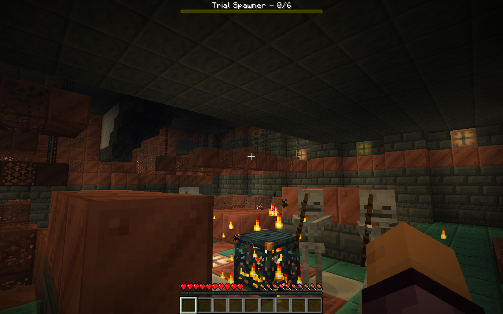

# BetterTrialChambers

BetterTrialChambers makes Minecraft's Trial Chambers work on a multiplayer
server. Every player gets their own loot from each vault, chambers rebuild
themselves on a timer, and nobody can dig out the spawners. It finds the
chambers in your world by itself, so most servers never register one by hand.

<figure><figcaption></figcaption></figure>

## How these pages work

Read them in order. Each step only uses what an earlier step showed you, and
every step has a picture of what you should see in the game.

These pages follow one server from the first start: Emerald SMP, a made-up
survival server. Follow along with your own server.

1. [Install it](getting-started/installation.md). Drop in the jar and start the server.
2. [Run the setup tour](getting-started/quick-start.md). Answer a few questions in game. For most servers this is the whole setup.
3. [Your first chamber is found](getting-started/first-chamber.md). Walk into a chamber and watch it get registered.

After that, [Run your chambers](running-chambers/what-players-see.md) shows
what players get and every part of the admin menu, one page at a time.


**No Trial Chambers in your world?** Superflat, one-block and custom worlds
have none for the plugin to find. Do the first two steps, then
[Register a chamber by hand](getting-started/your-first-chamber.md).


## What it needs

* **Paper, Purpur, Pufferfish or Folia.** One download works on every
  Minecraft version from 1.21.1 to 26.3. Spigot is not supported.
* **Java 21 or newer.** Minecraft 26.3 servers already run on Java 25.
* Nothing else. WorldEdit, WorldGuard, PlaceholderAPI, Vault and the land
  claim plugins are all optional extras.

## Premium add-ons

These need BetterTrialChambers and are sold on [ESMP.fun](https://esmp.fun/).

* [**MythicTrials**](https://esmp.fun/plugins/mythic-trials). Each player climbs through harder and harder runs of a chamber.
* [**Vault Crates**](https://esmp.fun/plugins/vault-crates). Crates built on real Trial Vault blocks.
* [**Wild Spawners**](https://esmp.fun/plugins/wild-spawners). Your own Trial Spawners, with your own mobs, anywhere in the world.

## Help

* [**Discord**](https://dc.esmp.fun). Questions, help and announcements.
* [**GitHub Issues**](https://github.com/ESMP-FUN/BetterTrialChambers/issues). Bug reports and ideas.
* [**Modrinth**](https://modrinth.com/plugin/trialchamberpro). Downloads and what changed in each version.

Free to use, no redistribution (see the
[LICENSE](https://github.com/ESMP-FUN/BetterTrialChambers/blob/master/LICENSE)).

Next: [Install it](getting-started/installation.md).
