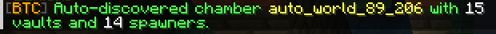
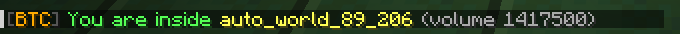
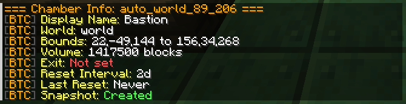

# Your first chamber is found

With the tour done, go and find a Trial Chamber. The plugin registers it the
moment you get close, and from then on it looks after it by itself.

## Step 1 - Go to a chamber

Players find chambers by exploring, deep underground. To go straight to the
nearest one, run:

```
/locate structure minecraft:trial_chambers
```

Click the green coordinates in the answer and press Enter to teleport there,
then fly down into the chamber.

## Step 2 - Watch it get registered

As the chamber comes into view, every operator online gets a line in chat:

<figure><figcaption></figcaption></figure>

The long name, here `auto_world_89_206`, is how the plugin tells chambers
apart. It is made from the world and the spot where the chamber sits, and you
use it in commands. Players never see it.

The plugin also saved a copy of the chamber, because the tour turned that on.
That copy is what the chamber is rebuilt from.


**No line in chat?** Check the first two tour questions are on with
`/trial setup`. Chambers someone already visited before the plugin was
installed are found too, the next time someone goes near them.


## Step 3 - Check where you are

Standing inside the chamber, run:

```
/trial list current
```

<figure><figcaption></figcaption></figure>

Away from every chamber, the same command names the nearest one instead, with
how far it is and a button to teleport there.

## Step 4 - Look at the chamber

Type `/trial info ` and press **Tab** to fill in the chamber's name, so you
don't have to type it:

```
/trial info auto_world_89_206
```

<figure><figcaption></figcaption></figure>

* **Display Name** is the name players see, picked for you from a list of
  names like Bastion and Cinderkeep. [Give a chamber a name](../running-chambers/names.md) changes it.
* **Exit** is where players go when it resets. You set it in
  [Resets and the exit point](../running-chambers/resets.md).
* **Reset Interval** is how long the chamber waits before it rebuilds, the
  answer you gave in the tour. `2d` is two days.
* **Snapshot: Created** means the copy is saved and the chamber is ready to
  rebuild.


**That is your first chamber.** Every other chamber in your world gets the
same, as players find them. There is nothing to repeat.


Next: [What players see](../running-chambers/what-players-see.md).
