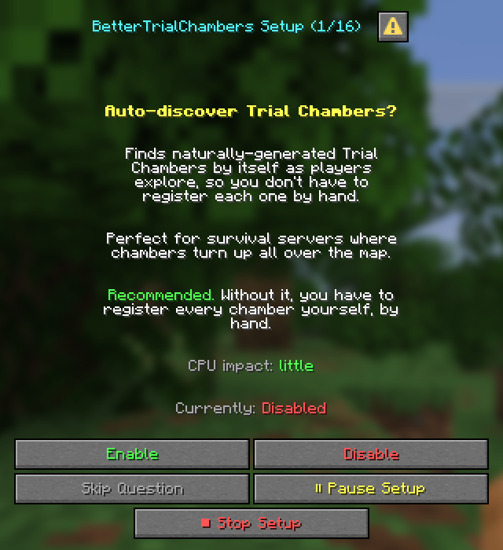
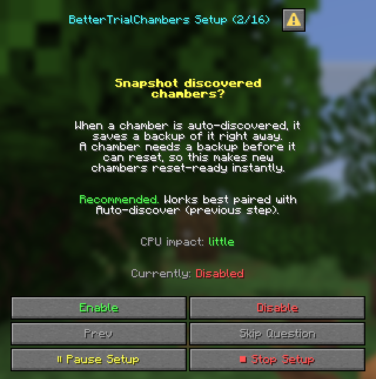
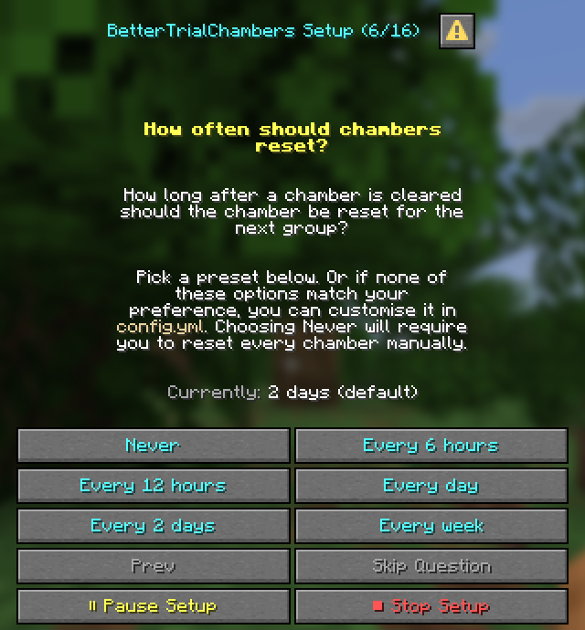
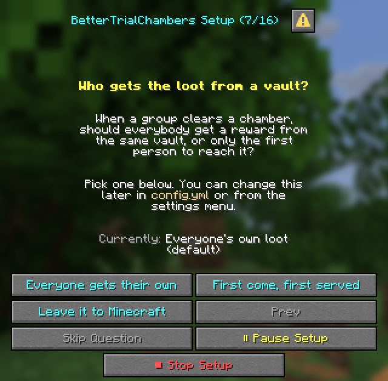
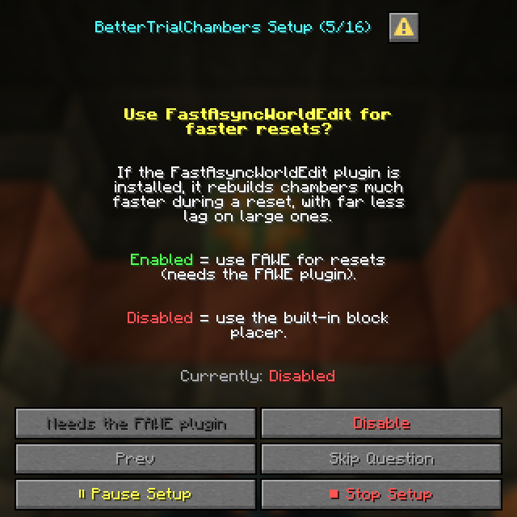
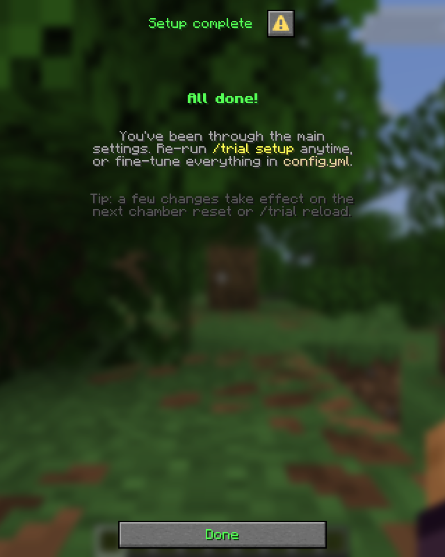

# Run the setup tour

The tour asks you about the plugin's main settings one at a time, in plain
words, and saves each answer for you. For most servers this is the only setup
there is.

## Step 1 - Start the tour

In game, as an operator, run:

```
/trial setup
```

A window opens over the game with the first question:

<figure><figcaption></figcaption></figure>

Every question looks the same:

* **The top line** shows where you are, here question 1 of 16.
* **The yellow line** is the question, with what it does underneath.
* **CPU impact** says how much work it gives your server. Most say "tiny" or
  "little", or nothing at all.
* **Currently** shows what the setting is right now.
* **Enable** and **Disable** save your answer and go to the next question.
  **Skip Question** goes on without changing anything, and **Prev** goes back
  one.


**On a server older than Minecraft 1.21.7?** The game has no such windows
there, so the tour runs in chat instead, with the same questions and the same
buttons as clickable text.


## Step 2 - Turn on the first two

Emerald SMP is a normal survival world, full of chambers nobody has found yet.
Two answers make the plugin look after all of them:

1. **Auto-discover Trial Chambers?** Click **Enable**. The plugin now finds
   each chamber by itself, the first time a player comes near it.
2. **Snapshot discovered chambers?** Click **Enable**. The plugin saves a copy
   of each chamber the moment it finds it. A chamber needs that copy before it
   can rebuild itself, so with this on, every chamber is ready straight away.

<figure><figcaption></figcaption></figure>


**That is the important part done.** With these two on, every Trial Chamber a
player walks into is registered, saved and put on a timer to rebuild. You can
skip every other question and still have a working setup.


## Step 3 - Pick how often chambers rebuild

Some questions have a choice instead of Enable and Disable. The sixth one
asks how long a chamber waits before it rebuilds itself for the next group:

<figure><figcaption></figcaption></figure>

Emerald SMP keeps **Every 2 days**, so it clicks **Skip Question**. Pick
**Never** only if you want to rebuild every chamber yourself.

## Step 4 - Pick who gets the loot

The seventh question decides what happens when a group reaches the same vault:

<figure><figcaption></figcaption></figure>

* **Everyone gets their own.** Each player opens every vault once and gets
  their own reward. Ten players, ten rewards. Most servers want this, and it
  is already set.
* **First come, first served.** The first player to open a vault takes the
  reward, and it stays shut for everybody else until the chamber rebuilds.
* **Leave it to Minecraft.** The plugin leaves vaults alone, and they work
  exactly like in a single-player world.

## Step 5 - Go through the rest

The other questions are already set the way most servers want them. Read
each one and click **Enable**, **Disable** or **Skip Question**:

| # | Question | Already set to | What it means |
| --- | --- | --- | --- |
| 3 | Drop vault loot on the ground? | Disabled | Loot goes straight into the player's inventory. Enable it to have it pop out of the vault instead, like in vanilla. |
| 4 | Confirm before chambers reset? | Disabled | Chambers rebuild on their own. Enable it to have them wait until an admin says yes. |
| 5 | Use FastAsyncWorldEdit for faster resets? | Disabled | Only for servers with the FastAsyncWorldEdit plugin. |
| 8 | Tidy up dropped items on reset? | Enabled | Items left on the floor are cleared away when a chamber rebuilds. |
| 9 | Clear leftover mobs on reset? | Enabled | Mobs left from the last group are removed. |
| 10 | Reset trial spawners? | Enabled | Spawners fight again and drop keys again after each rebuild. |
| 11 | Reset vault cooldowns? | Enabled | Players can open each vault again after a rebuild. |
| 12 | Track spawner wave progress? | Enabled | Counts the mobs each spawner sends. Needed for the next question. |
| 13 | Show the wave progress boss bar? | Enabled | A bar at the top of the screen shows how much of the fight is left. |
| 14 | Let players spectate after death? | Enabled | A player who dies can watch the rest of their group finish. |
| 15 | Track player statistics? | Enabled | Counts vaults opened, mobs killed and time spent, for the leaderboards. |
| 16 | Let Luck affect loot? | Disabled | Players with the Luck effect get a little more from each vault. |

Question 5 needs the FastAsyncWorldEdit plugin. Without it, the Enable button
is replaced by one that says it needs that plugin:

<figure><figcaption></figcaption></figure>

After the last question the tour says it's done:

<figure><figcaption></figcaption></figure>


**Need a break?** **Pause Setup** remembers which question you were on. Run
`/trial setup continue`, or click **[Resume]** in chat, to carry on from
there. **Stop Setup** ends the tour, and `/trial setup` starts it again from
the first question whenever you like.


Every answer is saved in `config.yml` as you click, so there is nothing to
reload. You can run the tour again at any time to change your mind.

Next: [Your first chamber is found](first-chamber.md).
