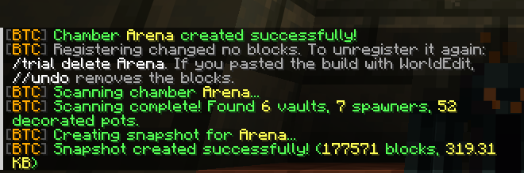

# Register a chamber by hand

**Most servers don't need this page.** If your world has Trial Chambers of its
own, the [setup tour](quick-start.md) already registers them as players find
them.

This page is for worlds with no chambers for the plugin to find: superflat
and one-block worlds, custom world generation, or `generate-structures` off.
It also works for a chamber you built or pasted yourself. You tell the plugin
where the chamber is, once, and from then on it is looked after like any other.

## Step 1 - Mark out the chamber

You need two opposite corners of a box around the whole chamber: every room,
hallway, spawner and vault, plus a few blocks to spare on every side. A
vault right on the edge of the box can be missed.

**With WorldEdit**, the easiest way: run `//wand`, left click the lowest
corner and right click the highest one.

**Without WorldEdit**, stand on each corner in turn and write down the three
numbers your F3 screen shows after "Block:".


**How big?** At least 31 blocks wide, 15 high and 31 deep. A normal Trial
Chamber is often more than 100 blocks across.


## Step 2 - Register it

Give the chamber a short name with no spaces, like `Arena`. Players won't see
it, they see a display name like the ones in
[Give a chamber a name](../running-chambers/names.md).

With your WorldEdit selection:

```
/trial generate wand Arena
```

Or with the two corners you wrote down:

```
/trial generate coords -150,-20,400 -50,40,500 Arena
```

The plugin registers the chamber, finds its vaults and spawners, and saves the
copy it rebuilds from, all in one go:

<figure><figcaption></figcaption></figure>

Nothing in the world changes. The command only tells the plugin where the
chamber is.


**Found 0 vaults?** The box missed them. Remove it with `/trial delete Arena`
and mark out a bigger one. If only one wing was missed, stand in that wing and
run `/trial scan add Arena` to grow the box into it.


## Step 3 - Set the exit point and check it

Stand at the entrance and run `/trial setexit Arena`, as in
[Resets and the exit point](../running-chambers/resets.md). Then:

```
/trial info Arena
```

When it shows **Snapshot: Created**, the chamber resets on the timer you
chose in the tour, hands out its own loot per player, and is protected, the
same as a chamber the plugin found by itself.


**Don't delete the files in `plugins/BetterTrialChambers/snapshots/`.** They
are the saved copies. A chamber without one can't reset.


Next: [Settings the tour doesn't ask about](basic-configuration.md).
