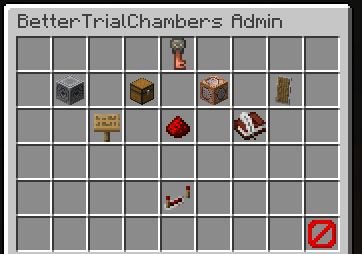
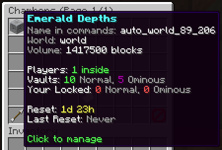
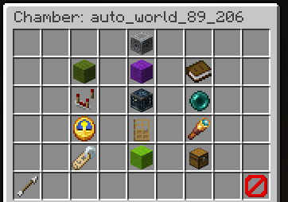

# The admin menu

Everything the plugin does can be changed from one menu, without opening a
file. The rest of this chapter uses it on every page.

## Step 1 - Open the menu

Run:

```
/trial menu
```

<figure><figcaption></figcaption></figure>

Hold your mouse over any item in the menu to read what it does. The ones you
need most:

* **Chambers**, every chamber the plugin looks after. The next step opens it.
* **Global Settings**, the on and off settings from the tour, for every
  chamber at once.
* **Protection Settings**, what players can't do inside chambers. See
  [Protection](protection.md).
* **Loot Tables**, what vaults hand out. See [Vault loot](loot.md).
* **Statistics**, the players' stats and leaderboards. See
  [Stats and leaderboards](stats.md).

## Step 2 - Find your chamber

Click **Chambers**. Each chamber is one item, shown by its display name, with
the name you use in commands, how many players are inside and when it next
rebuilds:

<figure><figcaption></figcaption></figure>

## Step 3 - Open the chamber's page

Click the chamber. Its page has everything for that one chamber:

<figure><figcaption></figcaption></figure>

| Item | What it does |
| --- | --- |
| **Rename** | Changes the name players see. See [Give a chamber a name](names.md). |
| The lodestone at the top | The chamber's name, size, vaults and when it next rebuilds. |
| **Normal Loot** and **Ominous Loot** | What this chamber's vaults hand out. See [Vault loot](loot.md). |
| **Chamber Settings** | How often it rebuilds, where players go, and its own protection. See [Resets and the exit point](resets.md). |
| **Vault Management** | Opens vaults again for one player or for everyone. |
| **Teleport** | Takes you to the middle of the chamber, or to its exit point with a right click. |
| **Reset Chamber** | Rebuilds the chamber now, with a short warning first. |
| **Snapshot** | Saves the chamber as it is now, as the copy it rebuilds from. |
| **Pause Chamber** | Stops everything the plugin does in this chamber, until you resume it. |


**Going straight to one chamber?** Name it:
`/trial menu auto_world_89_206` opens its page without the list. Press
**Tab** to fill in the name.


Next: [Give a chamber a name](names.md).
