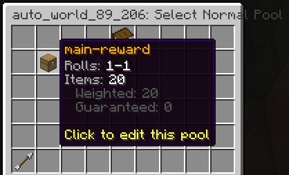
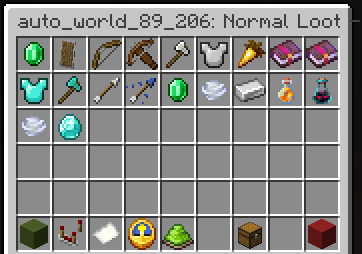
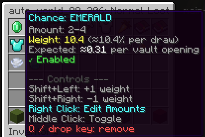

# Vault loot

Out of the box, vaults hand out much the same as in vanilla. This page changes
what one chamber's vaults give, from the menu.

## Step 1 - Open the chamber's loot

On the chamber's page in the [admin menu](admin-menu.md), click
**Normal Loot**. Ominous vaults have their own list under **Ominous Loot**,
and work the same way.

The loot comes in parts, called pools. Each opening of a vault takes
something from each part:

<figure><figcaption></figcaption></figure>

* **main-reward**, the one main item: emeralds, a bow, armour and so on.
* **extra-supplies**, one to three extras like arrows, wind charges and
  honey.
* **unique**, something rare like a golden apple or a trident. This part
  only runs on one opening in four.

## Step 2 - Look at a part

Click **main-reward**. Each item in it is shown, with how many come out and
how likely it is:

<figure><figcaption></figcaption></figure>

Hold your mouse over an item to see the details:

<figure><figcaption></figcaption></figure>

**Weight** decides how often an item is picked compared with the others. An
item with twice the weight comes out twice as often. The chance next to it
works that out for you.

## Step 3 - Add an item

Emerald SMP wants its first chamber to hand out the odd emerald block. Hold
the item in your hand and click **Add from Hand**. It joins the list with a
weight of 1, so it is rare.

Adding many at once? Click **Bulk add**, put the items in the chest that
opens, and close it. Enchantments, potions and custom names are kept.

## Step 4 - Change an item

On an item in the list:

| Do this | To |
| --- | --- |
| **Shift and left click** | Make it come out more often. |
| **Shift and right click** | Make it come out less often. |
| **Right click** | Change how many come out at once. |
| **Middle click** (the mouse wheel) | Switch it off without removing it. |
| Hold your mouse over it and press **Q** | Remove it. |

## Step 5 - Save

Nothing changes for players until you click **Save**. **Discard** throws away
everything since the last save.


**This chamber only.** Loot you edit on a chamber's page belongs to that
chamber, and every other chamber keeps its own. To change the loot of every
chamber that has none of its own, use **Loot Tables** in the main menu.


## More than items

Money, commands, potion effects, ominous bottles and items from other plugins
like Nexo, ItemsAdder and Oraxen are written in `loot.yml`.
[loot.yml](../configuration/loot.yml.md) has an example of each.

Next: [Stats and leaderboards](stats.md).
