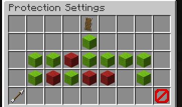
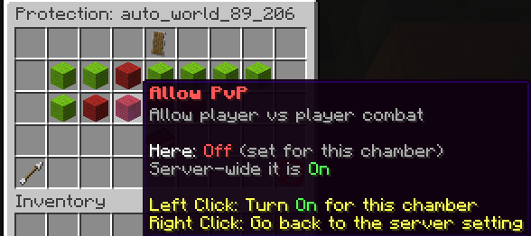

# Protection

Protection decides what players can't do inside a chamber. Out of the box
they can't break or place blocks, pour water or lava in, light fires, push
blocks in with pistons or take the item frames. Mobs can't blow holes in the
walls either.

## Step 1 - Look at the settings for every chamber

In the [admin menu](admin-menu.md), click **Protection Settings**:

<figure><figcaption></figcaption></figure>

Green is on, red is off. Click one to switch it. Each one says what it does
when you hold your mouse over it. The ones servers change most:

| Setting | Out of the box | Turn it the other way to |
| --- | --- | --- |
| **Allow PvP** | On | Stop players hurting each other inside chambers. |
| **Prevent Containers** | Off | Stop players using chests and barrels you put in a chamber yourself. Vaults always work. |
| **Members Only** | Off | Let only players with the `btc.bypass.entry` permission walk in, for chambers that belong to a rank. |
| **No Teleporting In** | Off | Stop players skipping the entrance with `/home`, `/tpa` or ender pearls. |
| **Freeze Nature** | Off | Stop leaves dropping, ice melting and plants growing inside a chamber. |

The very first item, **Protection System**, switches all of it on or off at
once.

## Step 2 - Change one chamber only

Emerald SMP lets players fight each other in every chamber except Emerald
Depths, which new players use. On that chamber's page, open
**Chamber Settings**, then **Protection**:

<figure><figcaption></figcaption></figure>

The same settings, for this chamber only. Click **Allow PvP** to turn it off
here. A setting you changed for this chamber shines, and its tooltip shows
what the rest of the server uses. Right click it to follow the server's
setting again, or click the book, **Use the Server Settings Again**, to undo
all of them.

## Who isn't stopped

Operators, and anyone with the `btc.bypass.protection` permission, can break
and build in chambers. That is how you repair one. Creative players and
spectators are not stopped at the walls by **Members Only** or
**No Teleporting In**.


**Using Lands, Residence or GriefPrevention?** Nothing to set up. Players
can't claim land that overlaps a chamber, and `/trial claims scan` lists any
claims that already do.


Next: [Vault loot](loot.md).
