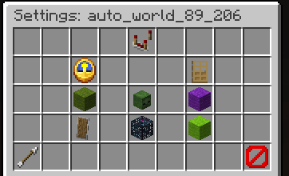
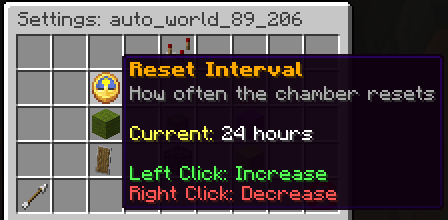
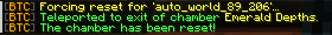

# Resets and the exit point

A reset puts a chamber back the way it was saved: every block, every spawner,
and every vault open again. This page sets how often that happens, and where
players go while it does.

## Step 1 - Open the chamber's settings

On the chamber's page in the [admin menu](admin-menu.md), click
**Chamber Settings**:

<figure><figcaption></figcaption></figure>

Every change here is saved as you click, for this chamber only.

## Step 2 - Change how often it resets

Click **Reset Interval** to make the wait longer, right click to make it
shorter. It steps through 1 hour, 6 hours, 12 hours, 24 hours, 48 hours,
1 week and Disabled. Disabled means it only resets when you tell it to.

Emerald Depths is the chamber closest to spawn, so it gets busy. Emerald SMP
sets it to **24 hours**, and leaves every other chamber on the two days from
the tour.

<figure><figcaption></figcaption></figure>


**Changing it for every chamber at once?** That is the question you answered
in the tour. Run `/trial setup` again, or set `default-reset-interval` in
`config.yml` in seconds: `86400` is one day, `172800` two days.


## Step 3 - Set the exit point

When a chamber resets, the players inside are moved out first. Without an
exit point they land on a safe spot just outside the walls. To pick the spot
yourself, stand where they should land, usually the chamber's entrance, facing
the way they should look. Then click **Exit Location** in the settings:

```
[BTC] Exit location set to your current position
```

Right click **Exit Location** later to teleport there and check it.

The command does the same, from where you stand:

```
/trial setexit auto_world_89_206
```

## Step 4 - Reset it now

To test it, go back to the chamber's page and use **Reset Chamber**:

* **Click** starts a five minute countdown, with a warning for the players
  inside.
* **Right click** starts a one minute countdown.
* **Shift and right click** resets it straight away.

Everyone inside is moved to the exit point, the chamber is rebuilt, and every
vault is open again for everyone. A big chamber takes a minute or two to
rebuild, a piece at a time so the server keeps running smoothly. Chat says
when it is done:

<figure><figcaption></figcaption></figure>

The command for a reset straight away is `/trial reset auto_world_89_206`.


**Changed the chamber on purpose?** If you built something into it that
should stay, save it again first: click **Snapshot** on the chamber's page.
Otherwise the next reset takes it away.


Next: [Protection](protection.md).
