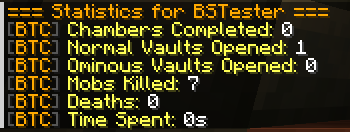
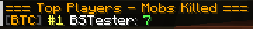
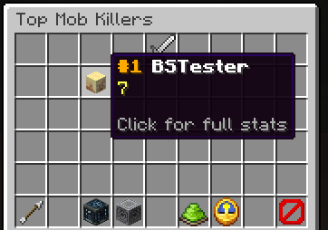

# Stats and leaderboards

The plugin counts what every player does in chambers: vaults opened, mobs
killed, deaths, chambers cleared and time spent inside. Players can look at
their own numbers and at the best players on the server.

## Step 1 - Look at your own stats

Every player can run:

```
/trial stats
```

<figure> ===' lines in chat"><figcaption></figcaption></figure>

As an operator, add a player's name to see theirs: `/trial stats Steve`.

## Step 2 - See who is on top

```
/trial leaderboard mobs
```

<figure><figcaption></figcaption></figure>

Instead of `mobs`, use `chambers`, `normal`, `ominous` or `time`. A player
only shows up once they have done something in a chamber.

## Step 3 - Or use the menu

In the [admin menu](admin-menu.md), click **Statistics**. Pick a list, like
**Mobs Killed**, to see the top players with their heads, or
**Your Statistics** for your own:

<figure><figcaption></figcaption></figure>


**Want them on a scoreboard or a hologram?** Install PlaceholderAPI. The
plugin adds its own placeholders by itself, see
[PlaceholderAPI](../getting-started/placeholders.md).



**That is everything players notice.** The pages after this one are for
servers that want to go further.


Next: [Settings the tour doesn't ask about](../getting-started/basic-configuration.md). No chambers in your world? [Register a chamber by hand](../getting-started/your-first-chamber.md) first.
