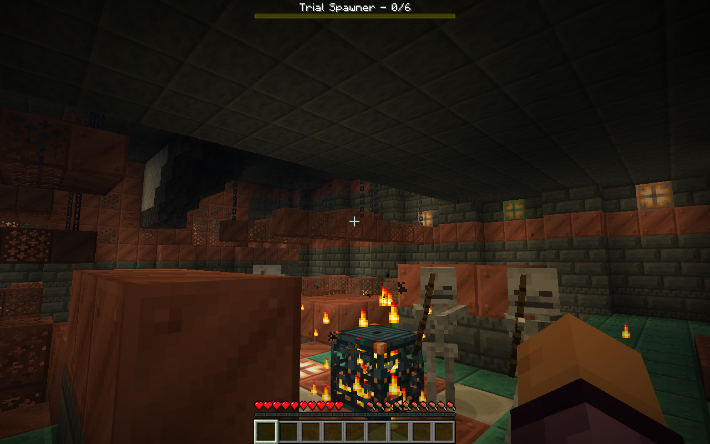
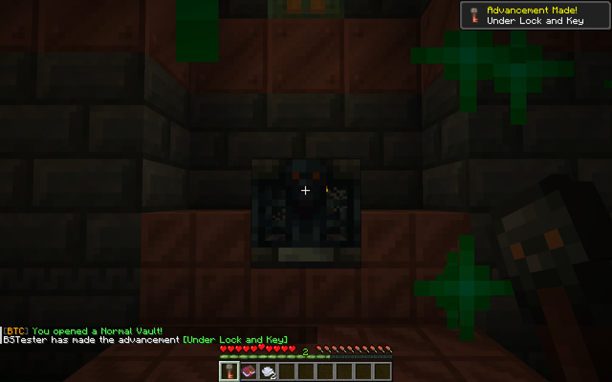
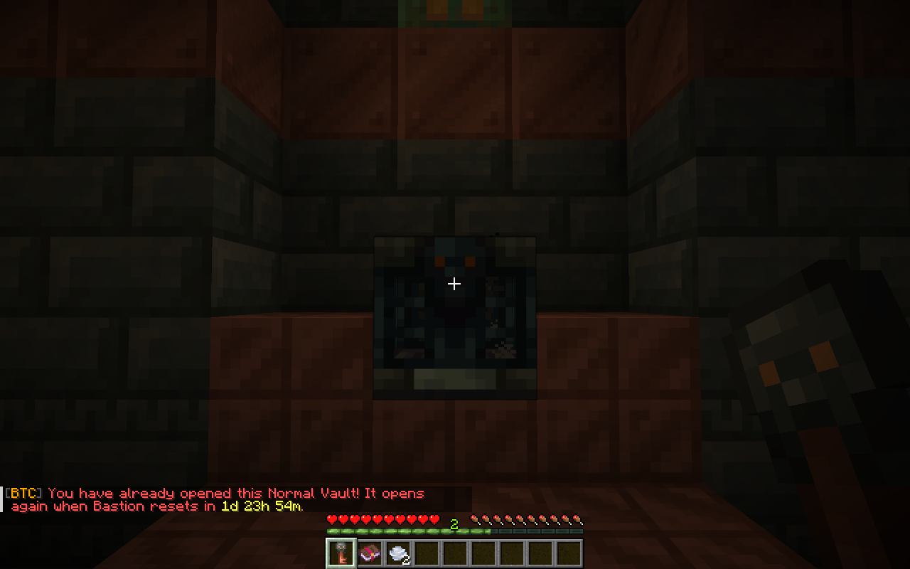
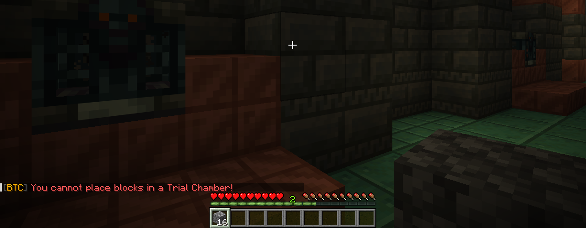

# What players see

The tour turned on everything players notice in a chamber. This page walks
through one run of Emerald SMP's first chamber, Bastion, the way a player sees
it.


**Trying this yourself? Use an account that is not an operator.** Operators
skip vault cooldowns and chamber protection, so they can test and repair
chambers. On an operator account, vaults open again and again, and blocks
break as normal.


## Step 1 - Fight a spawner

When a player walks up to a Trial Spawner, it starts sending mobs, as in
vanilla. A bar at the top of the screen counts the mobs beaten out of the whole
wave:

<figure><figcaption></figcaption></figure>

When every mob is beaten, the bar goes away. The
spawner drops a Trial Key for each player who fought, as in vanilla.

## Step 2 - Open a vault

With the key in hand, the player right-clicks a vault. The loot goes straight
into their inventory, and chat says so:

<figure><figcaption></figcaption></figure>

Every player who comes to the same vault gets their own reward from it,
however many came before them. That is the "Everyone gets their own" answer
from the tour.

## Step 3 - Try the same vault again

Each player opens each vault once. A second try tells them when it opens
again:

<figure><figcaption></figcaption></figure>

The chamber's name in that line is its display name, the one from
[Your first chamber is found](../getting-started/first-chamber.md).

## Step 4 - Try to break or build

Inside a chamber, players can't break blocks or place their own:

<figure><figcaption></figcaption></figure>

So nobody can dig out a spawner, wall off a vault or leave a mess for the next
group. [Protection](protection.md) shows what else is covered and how to
change it.

## Step 5 - The chamber rebuilds

When the chamber's timer runs out, everyone inside gets a warning five
minutes, one minute and thirty seconds before:

```
[BTC] Warning: Bastion will reset in 5 minutes!
```

Then they are moved just outside, the chamber is put back exactly as it was
saved, the spawners are ready again, and every vault opens again for
everyone.


**Died in a chamber?** The player is asked whether to watch the rest of their
group finish. **[Watch]** turns them into a spectator who can't leave the
chamber until the run ends.


Next: [The admin menu](admin-menu.md).
